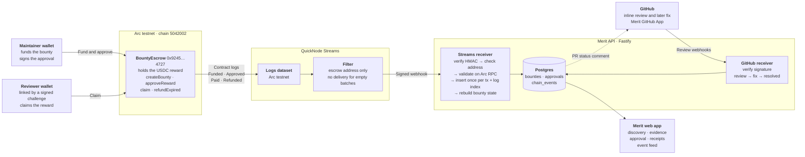
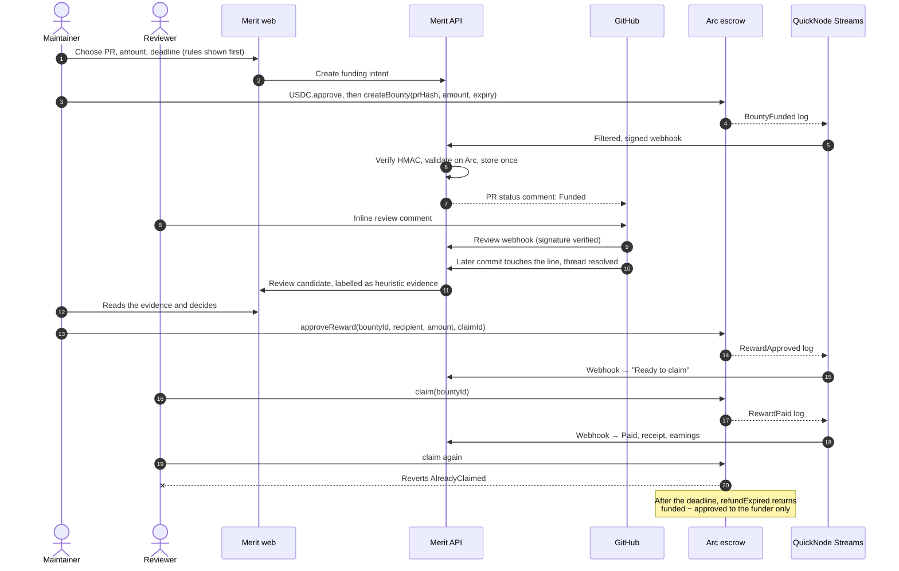
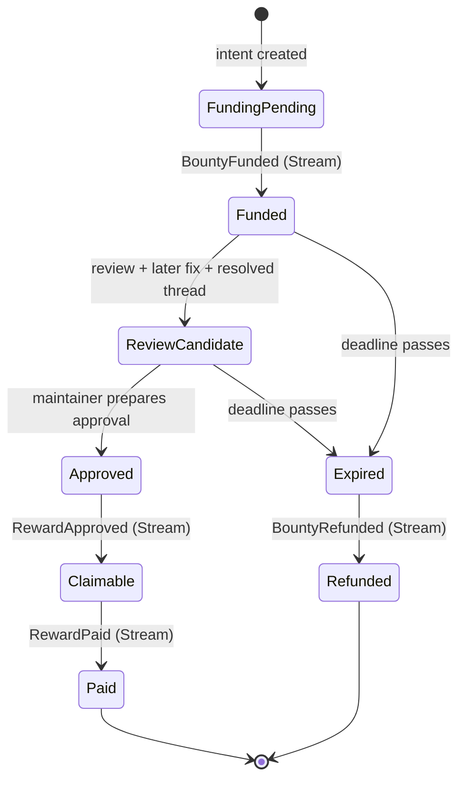

# Merit

**Paid code review on GitHub, funded before the work starts.**

A maintainer locks a USDC reward on a pull request *before* anyone reviews it. A reviewer leaves feedback on GitHub. If the maintainer decides that feedback led to a real fix, they approve the payout and the reviewer claims it, all on Arc. Every money state the app shows comes from escrow events delivered by QuickNode Streams.

[**Live app**](https://merit-theta-beige.vercel.app) · [Escrow on Arc explorer](https://explorer.testnet.arc.io/address/0x924525bF3f3A39f9c7f298E71aFf43F4c27a4727) · [API reference](docs/api.md) · [Contract interface](docs/escrow-interface.md) · [Stream configuration](#quicknode-streams-bounty) · 


## The problem

Open-source maintainers are buried in pull requests, and careful review is the bottleneck. Writing code gets rewarded through merged PRs and issue bounties. Catching the bug that would have shipped usually earns nothing. A reward promised *after* the work also leaves reviewers guessing whether it will ever be paid.

Merit pays for **review feedback that a maintainer verified led to a fix**, with the money **escrowed before the reviewer starts**.

## The product

| Screen | What it does |
| --- | --- |
| **Open source** (`/open-source`) | Funded, open bounties on verified public repositories. Search, filter by language, sort by reward or deadline. |
| **New bounty** (`/maintainer/new`) | Pick a repository and PR, choose a $5–$10 reward and a deadline, and see the rules **before** any money moves. |
| **Bounty** (`/bounties/[id]`) | Funding progress, the status rail, the GitHub review evidence (comment, later fix, resolved thread), approval, claim and refund. |
| **Approval** (`/bounties/[id]/approve/[candidate]`) | The trust decision. Shows exactly which review, recipient and amount the maintainer is authorizing from their own wallet. |
| **Reviewer** (`/reviewer`) | Link a payout wallet by signing a one-time challenge; see your reviews, approvals and claims. |
| **Receipt** (`/bounties/[id]/receipt`) | A shareable record linking the review, the fix, the recipient and the confirmed Arc transaction, or the refund to the funder. |
| **Event feed** (`/events`) | The indexed escrow events with block numbers, log indices and transaction links. |
| **PR status comment** | One bot comment on each funded PR, updated from Stream events: funded → ready to claim → paid / refunded. |

Amounts always read as **`$10.00 USDC`**, never raw units. Transaction hashes, blocks and explorer links are one click away but never needed to follow the flow.

---

## How it works

### Architecture



The core pipeline mirrors the money: wallets sign against the escrow on Arc, the escrow emits logs, QuickNode Streams filters them and pushes them to a signed webhook, and the Merit API turns them into the state the web app shows. GitHub feeds review evidence in from below, and the API writes one status comment back to the pull request. The backend only prepares calldata; the wallets sign.

Three sources of truth, kept separate on purpose:

- **GitHub** is the source of truth for reviews: who commented, on which line, whether a later commit touched it, and whether the thread was resolved.
- **The Arc escrow contract** is the source of truth for money. Only the funding wallet can approve, only the approved recipient can claim, and expired funds can only return to the funder.
- **QuickNode Streams** is the pipeline the product reads money state from. The backend joins GitHub evidence with Stream-delivered events. It **holds no key that can move escrowed funds**; it prepares calldata that the maintainer's own wallet signs.

### One bounty, end to end



### Bounty status machine



**Funded, Claimable, Paid and Refunded** are set only from Stream-delivered contract events. The UI never shows a money state the chain has not confirmed. A partial approval (for example $4 of $10) stays claimable after the unapproved $6 is refunded. Claim and refund are independent and can happen in either order.

---

## Consumer Applications (Track 3)

Merit is built for developers who will never read blockchain documentation:

- **GitHub-native.** Reviewers work where they already work: inline comments on a pull request. Sign-in is GitHub OAuth. Identity is the immutable GitHub user id, never a username.
- **The crypto stays out of the way.** Amounts are dollars. USDC is also Arc's gas token, so nobody needs a second token to pay fees. The only wallet steps are the ones that move money (deposit, approve, claim), and each says plainly what it does.
- **Trust you can see.** Rules appear before funding. The approval screen names the exact review, recipient and amount. Receipts and the PR comment make every payout publicly traceable.
- **Honest evidence.** The review-to-fix heuristic is labelled as a heuristic. The maintainer, not the backend, decides whether a review earned the reward.
- **Designed states.** Every status, including refusals such as a duplicate claim, an unauthorized approver, an over-budget approval or an expired bounty, has a deliberate screen. See [`/states`](https://merit-theta-beige.vercel.app/states).

---

## Best use of Arc

### Contracts and addresses

| | |
| --- | --- |
| Network | **Arc testnet**, chain id `5042002`, RPC `https://rpc.testnet.arc.io` |
| **BountyEscrow** (deployed by this team, source-verified) | [`0x924525bF3f3A39f9c7f298E71aFf43F4c27a4727`](https://explorer.testnet.arc.io/address/0x924525bF3f3A39f9c7f298E71aFf43F4c27a4727) |
| Deploy transaction / block | [`0x8f46e028…6f5bfb`](https://explorer.testnet.arc.io/tx/0x8f46e02893a7589cb1df377dae636fa2fce687657b0fe200ef0a23eca26f5bfb) / `72270484` |
| **USDC** (Arc ERC-20, 6 decimals; also the native gas token) | `0x3600000000000000000000000000000000000000` |
| Source and tests | [`contracts/src/BountyEscrow.sol`](contracts/src/BountyEscrow.sol), [`contracts/test`](contracts/test) (Foundry) |
| ABI | [`docs/escrow-abi.json`](docs/escrow-abi.json) |

### How Merit uses Arc

1. **USDC escrow is the core of the product.** `createBounty` pulls the reward into the contract before any review exists. A reviewer can see the money is really there.
2. **USDC as gas means predictable, single-currency fees.** Maintainers and reviewers hold one asset. The reward, the fee and the balance are all in dollars.
3. **The contract enforces the guarantees, not the backend:**
   - only the wallet that funded a bounty can approve its payout;
   - the approved recipient claims **exactly once** (a second claim reverts `AlreadyClaimed`);
   - a payout can never exceed the funded amount;
   - a claim id (derived from the GitHub review comment) can be paid only once;
   - after the deadline, `refundExpired` returns **funded minus approved** to the original funder only. Anyone may send it, but nobody can redirect it;
   - there is no owner, admin key or upgrade path.
4. **Standard EVM tooling.** Solidity + OpenZeppelin, Foundry for build, tests and deployment (33 tests, including fuzz tests), viem and wagmi in the app.

```solidity
function createBounty(bytes32 prHash, uint256 amount, uint64 expiry) external returns (uint256 bountyId);
function approveReward(uint256 bountyId, address recipient, uint256 amount, bytes32 claimId) external;
function claim(uint256 bountyId) external;
function refundExpired(uint256 bountyId) external;
```

All amounts are integer 6-decimal units everywhere: Solidity, Postgres and the API. `$10.00 = 10000000`. Only the UI formats for people. Recorded testnet transactions, including an actual reverted duplicate claim, are in [docs/escrow-interface.md](docs/escrow-interface.md#nov-14-exit-test-live-run-on-arc-testnet).

---

## QuickNode Streams bounty

### What Streams drives

Streams is **the only way money state reaches Merit.** The backend never polls the chain for events. Every delivered escrow log:

- moves a bounty between **funded, claimable, paid and refunded**;
- feeds the **event feed** (`/events`), **receipts**, **reviewer earnings** and the maintainer **dashboard totals**;
- triggers an automated off-chain action: the **PR status comment** on GitHub is created or edited to match (funded → ready to claim, mentioning the reviewer → paid with a receipt link, or refunded).

### Stream configuration

Stream `merit-escrow-arc-testnet`, inspected in the QuickNode dashboard on November 19–20 ([sanitized record](docs/quicknode-verification.json)):

| Setting | Value | Why |
| --- | --- | --- |
| **Network** | Arc Testnet (chain `5042002`) | The escrow lives there, and it is the only chain Merit uses. |
| **Dataset** | **Logs** | Every escrow state change is one of four events (`BountyFunded`, `RewardApproved`, `RewardPaid`, `BountyRefunded`). A log carries exactly what the receiver decodes: `address`, `topics`, `data`, `transactionHash`, `logIndex`, `blockNumber`. Blocks or receipts would ship far more data for no gain. |
| **Filter** | Escrow address only ([code](#filter)) | Drops every unrelated log on the chain. Skips a delivery entirely when a batch has no escrow log, so the backend is only woken for real escrow activity. |
| **Destination** | Webhook → `https://merit-backend-seven.vercel.app/webhooks/streams`, compression **none** | Push delivery with retries, no polling. The receiver verifies QuickNode's HMAC over the exact uncompressed body. |
| Start block | `72366828` (escrow deployed at `72270484`) | Earlier history is available through a bounded historical backfill into an isolated database rather than rewinding production. |
| Batch size | 5 blocks, Elastic Batch on | Small batches keep event-to-UI latency low. |
| Reorg handling | **Restream on reorg** enabled | Corrections are delivered so orphaned payouts or refunds can be removed. |
| Retries | 30 s timeout, retry after 1 s, pause after 3 failures | Bounded retries; a paused Stream resumes with "continue where it left off". |

### Filter

Checked in at [`backend/scripts/streams-filter.js`](backend/scripts/streams-filter.js) and pasted into the Stream:

```js
function main(stream) {
  var ESCROW = "0x924525bf3f3a39f9c7f298e71aff43f4c27a4727";
  var logs = [];
  function walk(x) {
    if (Array.isArray(x)) { for (var i = 0; i < x.length; i++) walk(x[i]); return; }
    if (x && typeof x === "object") {
      if (typeof x.address === "string" && Array.isArray(x.topics)) {
        if (x.address.toLowerCase() === ESCROW) logs.push(x);
        return;
      }
      for (var k in x) walk(x[k]);
    }
  }
  walk(stream && stream.data);
  var metadata = stream && stream.metadata || {};
  // Empty corrected blocks must still remove previously indexed logs. Metadata belongs inside the HMAC body.
  return logs.length || (metadata.reorgs || []).length || (metadata.blocks_reorged || []).length
    ? { data: logs, metadata: metadata } : null;
}
```

- **Address match** is case-insensitive.
- **Any nesting depth** is walked, so a payload layout change cannot silently drop events.
- **Reorg metadata** stays inside the signed body.
- **Empty ordinary batches** return `null`, so no delivery is made.

### Receiver

[`backend/src/streams/webhook.ts`](backend/src/streams/webhook.ts) handles each delivery:

1. **Verifies the signature:** HMAC-SHA256 of `x-qn-nonce + x-qn-timestamp + body`, with a constant-time compare. It rejects with 401 before parsing anything.
2. **Checks the address:** it keeps only logs from the configured escrow, without relying on the filter alone.
3. **Validates against Arc:** each log must match the canonical block and transaction receipt. RPC is used for validation only, never as a source of new events.
4. **Inserts each event once:** keyed on `(chain_id, contract, tx_hash, log_index)`. Retries, replays, overlapping backfills and out-of-order delivery cannot double-pay or double-transition.
5. **Rebuilds bounty state** from all stored canonical events, applying reorg corrections. It then syncs the PR status comment within a bounded time budget.

**Backfill and recovery:** because state is rebuilt from the full event set, a historical backfill or a replay converges to the same result. The [replay demo](backend/README.md#replay-demo) rebuilds an isolated database from public Arc history and shows that a second pass changes nothing.

---

## Run it

### Sample mode (no wallet, backend or GitHub needed)

```sh
cd web
npm ci
cp .env.example .env.local   # NEXT_PUBLIC_MOCK=1
npm run dev                  # http://localhost:3000
```

Every screen and every state renders from labelled sample data. The persona bar switches between maintainer and reviewer. Try `/open-source`, `/states`, `/bounties/b-111` (partial payout and refund) and `/maintainer/new` (includes a 5-minute demo deadline).

### Full stack

| Part | Setup |
| --- | --- |
| Contracts | [contracts/README.md](contracts/README.md): Foundry, `make -C contracts test` |
| Backend | [backend/README.md](backend/README.md): Node 22+, PostgreSQL 16 (`docker compose up -d db`), GitHub App and Stream settings |
| Web | [web/README.md](web/README.md): live mode points at the backend; wallets via wagmi |

### Checks

```sh
make -C contracts test
docker compose -f backend/docker-compose.yml up -d db
npm --prefix backend ci && npm --prefix backend run typecheck && npm --prefix backend test
npm --prefix web ci && npm --prefix web run lint && npm --prefix web run typecheck
npm --prefix web run check:accounting && npm --prefix web run check:deposit
NEXT_PUBLIC_MOCK=1 npm --prefix web run build
```

CI runs contract, backend and web checks plus a secret scan on every pull request.

### Repository layout

```
contracts/   Solidity escrow, Foundry tests, deploy script
backend/     Fastify API, GitHub App + Streams receivers, PostgreSQL (Drizzle), expiry sweep
web/         Next.js app: discovery, maintainer and reviewer flows, receipts, event feed
docs/        Frozen interfaces (ABI, API), Stream and release verification, demo and acceptance records
```

---

## Trust model and security

- **GitHub** decides who reviewed what. **Arc** decides where money can go. **Streams** decides what the app shows as money state.
- **No custody.** The backend has no key that can move escrowed USDC. Only the funding wallet can approve; only the approved recipient can claim; refunds go only to the funder.
- **Identity.** Immutable GitHub user ids; maintainer permission is re-checked live at approval time. The PR author, bots and the approver cannot be paid for that bounty. The recipient must differ from the funding wallet.
- **Webhooks.** GitHub (`X-Hub-Signature-256`) and QuickNode (HMAC) signatures are verified on the raw body with constant-time compares before parsing.
- **Secrets** stay server-side; the web app holds none.


## Team

| | GitHub |
| --- | --- |
| Ravindu Ranasinghe | [@ravindu-ranasinghe](https://github.com/ravindu-ranasinghe) |
| Eric He | [@HeEric2007](https://github.com/HeEric2007) |
| Omar El-Banna | [@omar-elbanna](https://github.com/omar-elbanna) |
| Max Suslov | [@Max-Suslov](https://github.com/Max-Suslov) |
