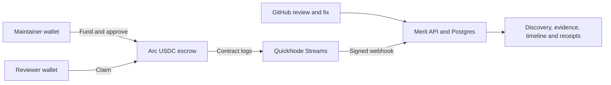

# Merit

**A little credit for a good catch.** Fund a code-review reward on GitHub, help an author fix a problem, and receive a maintainer-approved USDC payout on Arc.

[Live application](https://merit-theta-beige.vercel.app) · [API](docs/api.md) · [Escrow and contract address](docs/escrow-interface.md) · [Submission and demo guide](docs/hackathon-submission.md)

Merit pays for review feedback that a maintainer decides led to an improvement. A maintainer deposits the reward before the review happens. The reviewer works on GitHub and claims the reward after explicit approval. Testnet prototype: the USDC has no monetary value.

## Try the product

- **Open source** lists verified public repositories with open, funded bounties. Search by repository or pull request, filter by language, and sort by reward or deadline.
- **Bounty detail** shows the review text, author identities, exact pending checks, and the path from comment to payout. Recheck GitHub to recover missed review webhooks.
- **PR badges** link a pull request to its live reward. Copy the Markdown from bounty detail; the SVG reflects current status.
- **Reviewer profiles** show public contributions, confirmed approvals, and indexed earnings. Unclaimed approvals do not count as earnings.
- **Payout receipts** link the review, subsequent revision, recipient, and confirmed transaction. The indexed claim and recipient must match the approval, and the displayed amount comes from the payment event. An unpaid bounty cannot produce a paid receipt.

## Run locally

Requires Node 22+; the backend integration tests use PostgreSQL. No wallet or API credentials are needed for the explicitly labelled sample mode:

```sh
cd web
npm ci
cp .env.example .env.local
npm run dev
```

Set `NEXT_PUBLIC_MOCK=1` for sample mode. Open `/open-source`, `/states`, or `/reviewer`. The sample persona bar switches maintainer and reviewer accounts. Sample transactions are fictional.

For the real backend and GitHub App, follow [backend setup](backend/README.md) and [web live-mode setup](web/README.md). Production refuses development secrets and mock GitHub authentication. No additional database migration is needed for discovery or review display metadata.

## How it works



GitHub is the source of review evidence. An inline review comment becomes a candidate when a later revision touches the relevant context and the thread is resolved. This heuristic can fail after line movement, rebasing, or force-pushes; it does not prove causality or usefulness. The UI distinguishes an unavailable comparison from a missing fix. A maintainer makes the payment decision.

The backend prepares calldata and holds no key that can move escrowed funds. The maintainer signs from the funding wallet; the reviewer claims from the approved recipient wallet. Immutable GitHub IDs determine identity. Bots, the PR author, and an approver's own review cannot receive that approval. Each bounty pays one reviewer once; claim IDs cannot be reused.

Money states come from indexed contract events. Badges, public discovery, and reviewer profiles verify repository visibility through GitHub. Private review details require current repository access. GitHub display names are presentation only; authorization always uses current GitHub permissions.

## Arc and QuickNode

The core escrow is deployed on **Arc testnet, chain `5042002`**, at [`0x924525bF3f3A39f9c7f298E71aFf43F4c27a4727`](https://explorer.testnet.arc.io/address/0x924525bF3f3A39f9c7f298E71aFf43F4c27a4727). Rewards use USDC at `0x3600000000000000000000000000000000000000`, with six decimal places. Amounts stay integer strings throughout the API and use `BigInt` for totals and comparisons. [Contract functions, risks, and recorded testnet transactions](docs/escrow-interface.md).

QuickNode Streams is the core source of funding, approval, payment, and refund events. Its **Arc testnet Logs dataset** starts at deploy block `72270484`, filters for the escrow address, and delivers uncompressed JSON to `POST /webhooks/streams`. The receiver validates HMAC signatures and deduplicates by chain, contract, transaction hash, and log index. It rebuilds status from all indexed events, so replays and backfills cannot create another payout. [Full network, dataset, filter code, destination, and verification limits](backend/README.md#quicknode-streams).

## Checks

```sh
cd backend
docker compose up -d db
npm ci
npm run typecheck
npm test
```

```sh
cd web
npm ci
npm run lint
npm run typecheck
npm run build
```

Tests exercise signatures, wallet binding, payout approval constraints, event reconciliation, public/private discovery, review recovery, comparison failures, and SVG badge output. Browser checks should cover value sorting, search, recheck, copying, profiles, paid/unpaid receipts, and mobile layouts before a release.

## Current limits

This is a testnet prototype, not an audited production payment service. Review quality remains subjective; collusion is possible. Streams delivery is eventually consistent, and reorg handling is not implemented. Display caches and recheck throttling are bounded in-memory caches per API instance; reads and visibility checks still depend on GitHub availability. Discovery and profile queries target a hackathon-sized set of bounties; add pagination and batched aggregation before broad public adoption.
